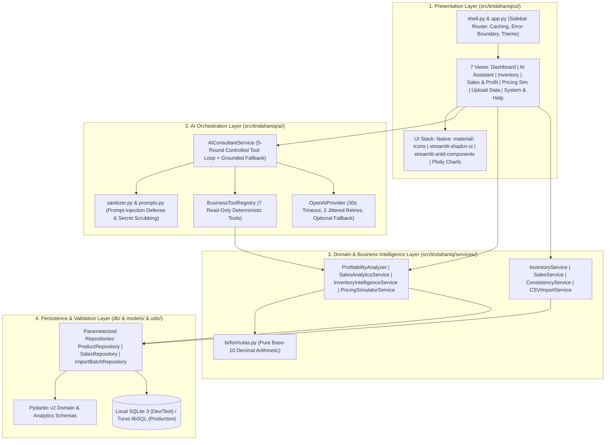

# TindahanIQ — System Architecture & Technical Reference

> For the complete production tech stack, runtime contracts, and caching/resilience policies, see [tech-stack.md](tech-stack.md), [GLOSSARY.md](../GLOSSARY.md), and [docs/adr/](adr/).

## 1. Architectural Overview

**TindahanIQ** follows a strict **Four-Layer Modular Architecture** where dependencies flow unidirectionally downward. Neither the Streamlit presentation layer nor the AI LLM layer ever performs authoritative arithmetic or executes raw SQL directly.

---

## 2. Core Engineering Decisions

### 2.1 Exact Base-10 Monetary Precision (`INTEGER` Centavos ↔ `Decimal`)

Floating-point (`float`) arithmetic introduces binary representation drift (e.g., `0.1 + 0.2 != 0.3`). TindahanIQ stores all PHP (`₱`) prices, costs, and revenues in SQLite as exact integer centavos (`₱12.25` → `1225`) and hydrates them into quantized Python `Decimal("12.25")` (`ROUND_HALF_UP`) across all domain models and BI engines.

### 2.2 Historical Price & Cost Snapping

Retailers periodically adjust selling prices or face supplier cost (`puhunan`) hikes. Every row in `sales_transactions` captures `unit_price_at_sale` and `unit_cost_at_sale` at transaction/import time so catalog price edits only affect future sales without distorting historical gross profit or margin reports.

### 2.3 Stock Ledger Conservation Invariant

Every stock-changing operation—initial catalog creation, CSV inventory sync, supplier restock, spoilage deduction, physical count reconciliation, and live walk-in POS sale—executes atomically inside `DatabaseManager.transaction()` (`BEGIN IMMEDIATE`) and appends a signed `inventory_adjustments` audit row. `ConsistencyService.verify_data_consistency()` reconciles `inventory.current_stock == COALESCE(SUM(inventory_adjustments.quantity_delta), 0)` across the entire store.

### 2.4 Zero-Hallucination AI Tool Architecture & Untrusted Data Defense

1. **Read-Only Deterministic Tools:** `AIConsultantService` exposes 7 read-only tools (`get_store_overview`, `search_store_products`, `analyze_profitability`, `analyze_sales_trends`, `get_restock_recommendations`, `plan_budget_restock`, `simulate_price_change`) backed by `services/bi/`. No tool can mutate data, execute SQL, or run arbitrary Python code.
2. **Prompt-Injection Fencing:** Strings originating from uploaded CSVs (`product_name`, `category`, `sku`) are stripped of control characters, scrubbed of role delimiters (`<system>`, `[INST]`, triple-backticks), and labeled with `_data_notice` inside JSON tool payloads.
3. **OpenAI-Compatible & Grounded Fallback:** `OpenAIProvider` supports standard Chat Completions tool calling, and `AIConsultantService` automatically falls back to deterministic pre-grounding when a custom endpoint omits native tool calls.

---

## 3. Database Schema Summary (`src/tindahaniq/db/schema.sql`)

| Table                     | Primary Key    | Relationships & Key Constraints                                                                           |
| :------------------------ | :------------- | :-------------------------------------------------------------------------------------------------------- |
| `products`              | `id`         | `UNIQUE(sku)`, `unit_cost_centavos >= 0`, `selling_price_centavos > 0`, `is_active IN (0, 1)`     |
| `inventory`             | `product_id` | `1:1` FK to `products(id) ON DELETE CASCADE`, `current_stock >= 0`, `lead_time_days >= 1`         |
| `inventory_adjustments` | `id`         | `N:1` FK to `products(id) ON DELETE RESTRICT`, `quantity_delta != 0`                                |
| `import_batches`        | `id`         | Tracks `INVENTORY` and `SALES` CSV uploads with SHA-256 `file_checksum`                             |
| `sales_transactions`    | `id`         | `N:1` FK to `products(id) ON DELETE RESTRICT`, partial unique index on `(external_ref, product_id)` |
